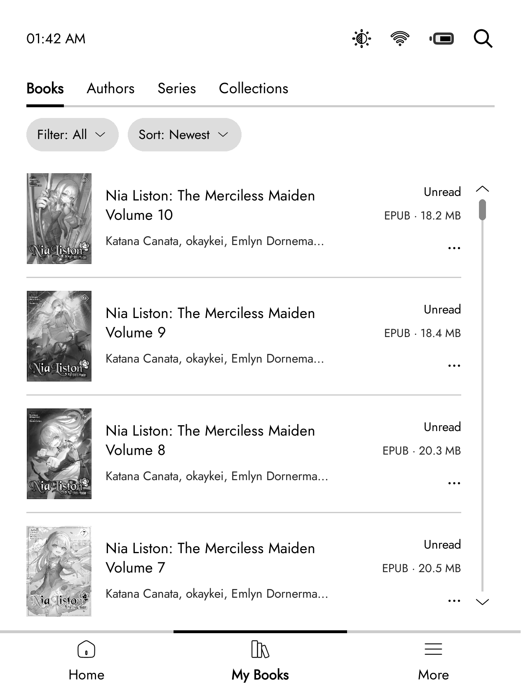
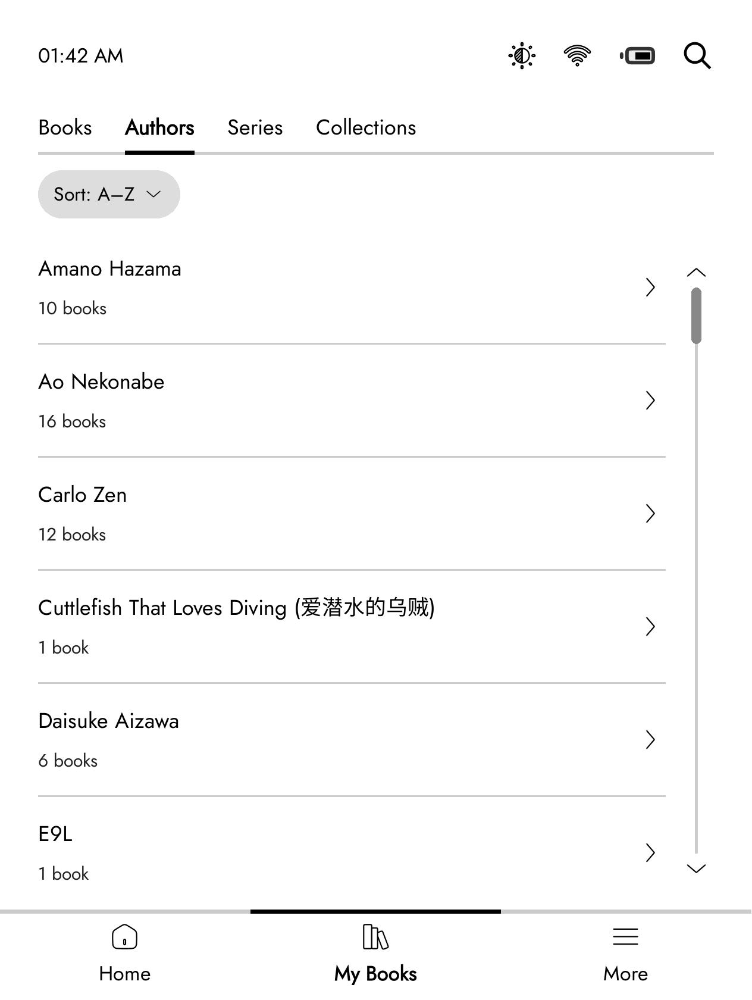
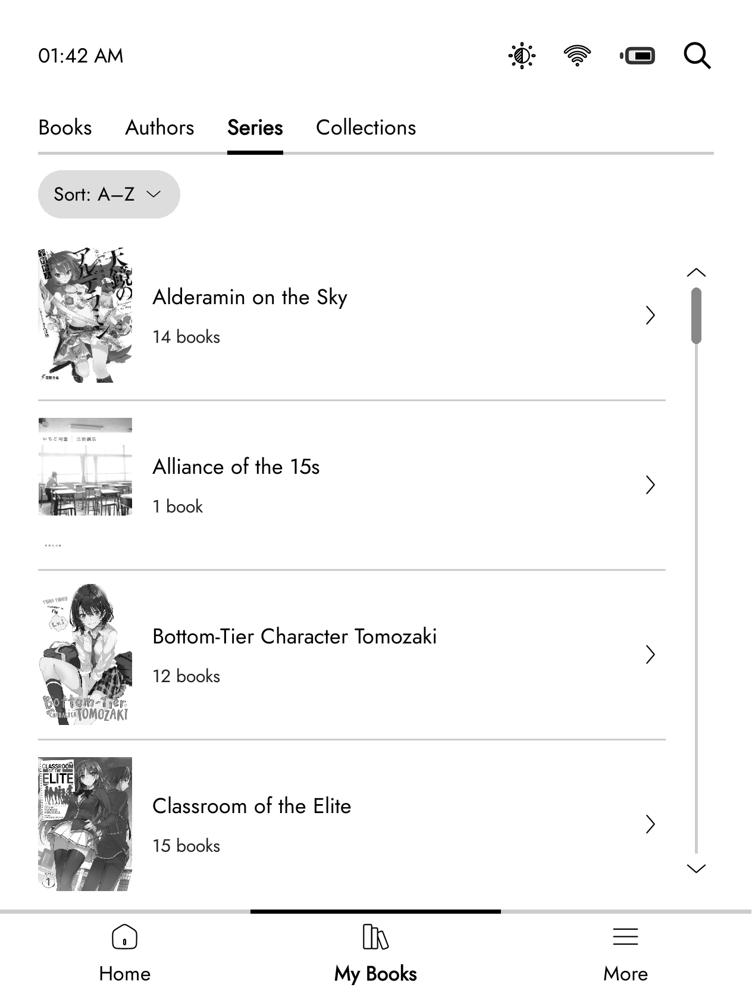

# Kobold

**A home screen for KOReader with the calm, familiar look of your e-reader's original software.**
 

---

Kobold is a [KOReader](https://github.com/koreader/koreader) plugin that gives you a proper home screen. Your current books up front, your library a tap away, and everything else out of the way. Made out of love for the look of the stock reader software, rebuilt to run inside KOReader.

## Screenshots

| Home | My Books |
|:---:|:---:|
|  |  |

| Authors | Series |
|:---:|:---:|
|  |  |

## Features

- **Home** with the books you are reading, your library and a collection at a glance, plus your reading stats
- **My Books** with Books, Authors, Series and Collections tabs, in list or grid view
- **Filter and sort** your books by status, date added or title
- **Collections** you can create, rename and fill with books right from Kobold
- **Quick settings** for brightness, warmth, Wi-Fi and battery from the status bar
- **Customisable reading stats** on the home screen, with your own text and tap actions
- **Fast**, with covers and book info cached so screens open quickly

## Planned

### Next

- **Book details** page with the cover, synopsis and file details. The "..." on a book will show Read now, View Details and KOReader Details
- **Collections** that work like the stock reader: a new collection screen, adding books with filter, sort and search, book counts on the right, and your own book order inside each collection

### Later

- **Activity** tab with your current book, reading time, sessions and how many books you have finished
- **Custom status bar and nav bar**, add, remove and reorder items, with your own icons

## Requirements

- [KOReader](https://github.com/koreader/koreader), any reasonably recent build
- A Kobo, Kindle, or other device KOReader supports
- The Cover Browser plugin enabled (it ships with KOReader) for book covers

## Installation

1. Go to the [Releases](https://github.com/unitreign/kobold/releases/latest) page and download `Kobold.koplugin.zip`
2. Extract the zip and you should get a folder called `Kobold.koplugin`
3. Copy that folder into KOReader's plugins folder:
   - **Kobo:** `/mnt/onboard/.adds/koreader/plugins/`
   - **Kindle:** `extensions/koreader/plugins/`
   - Other devices: wherever your KOReader `plugins/` folder lives
4. Restart KOReader
5. Open Kobold from the file browser menu, or set it as your start screen under **Start with > Kobold Home**

## Uninstall

Delete the `Kobold.koplugin` folder from your plugins folder and restart KOReader.

## License

Kobold is licensed under the **GNU General Public License v3.0**. See [LICENSE](LICENSE).

---

If Kobold is useful to you, consider supporting development.

